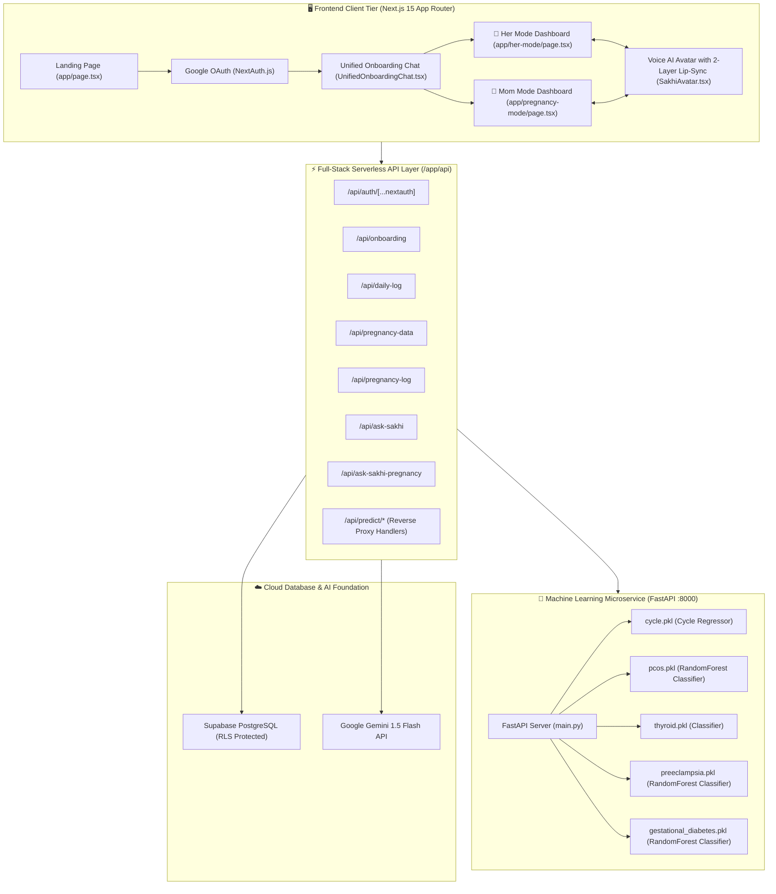
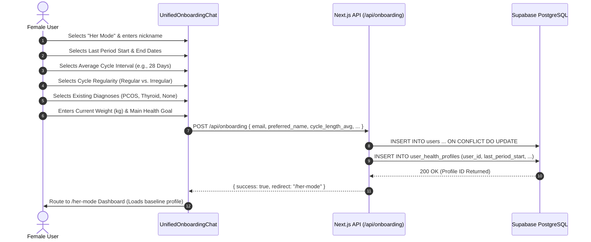
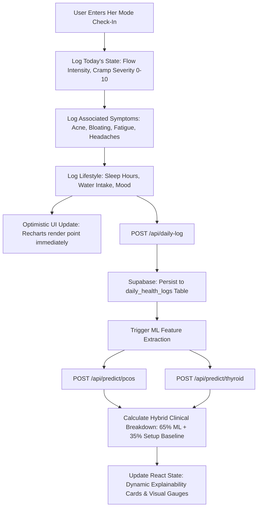
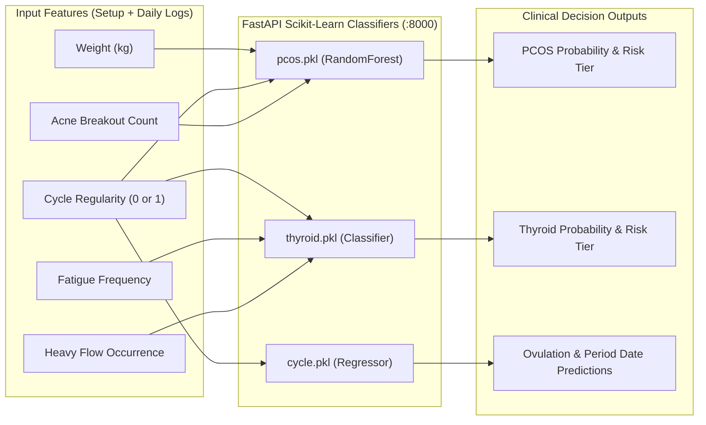
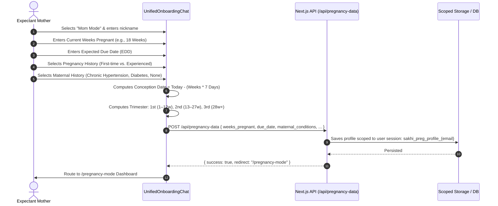
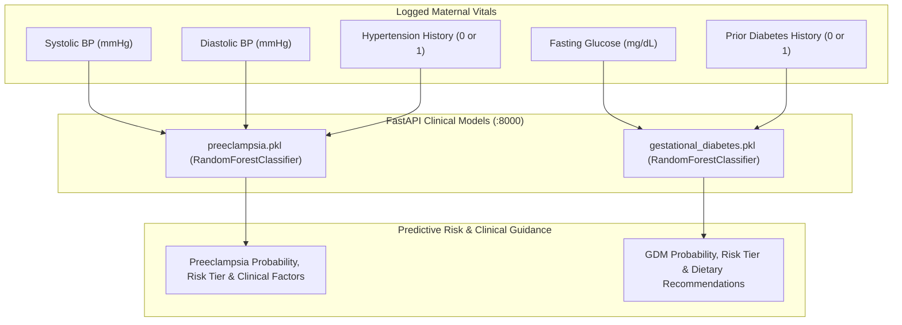
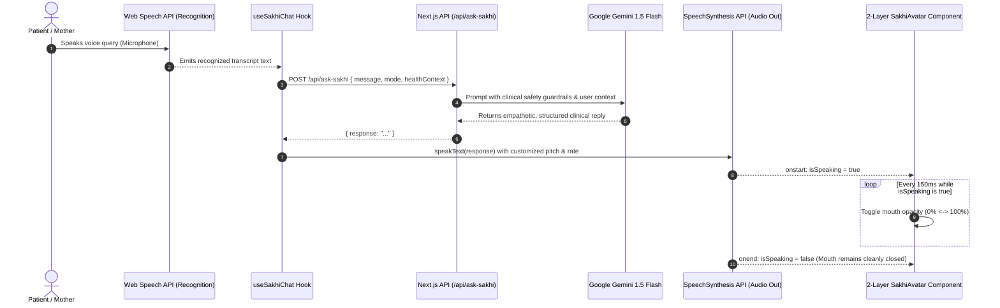
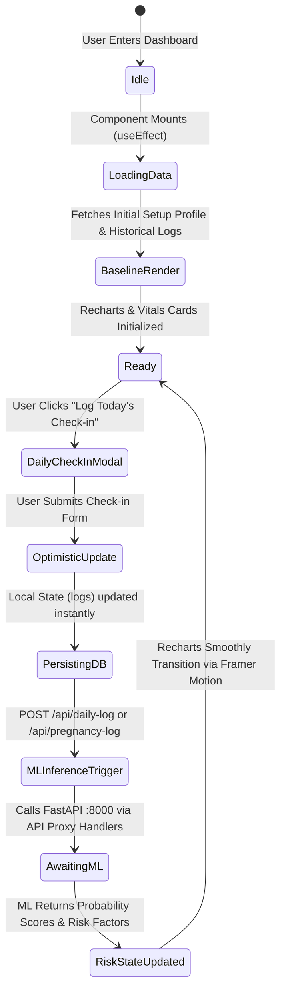
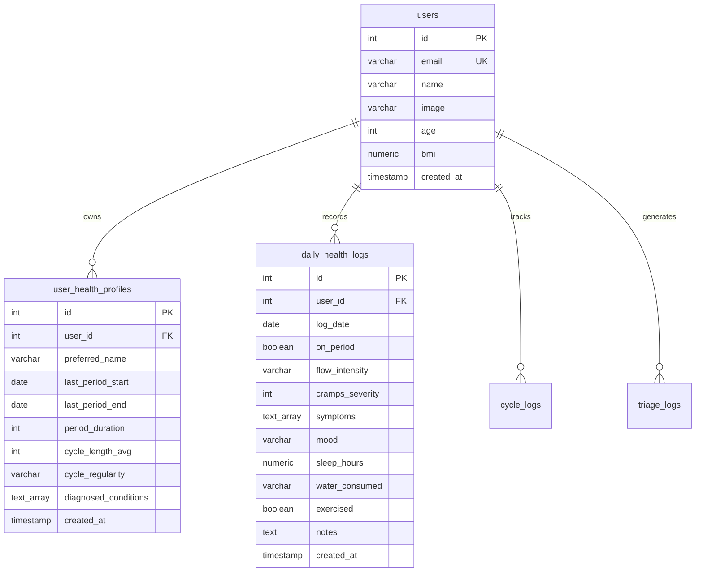

# 🌸 SAKHI: System Architecture Blueprint
### Full-Stack Architecture, Machine Learning, Clinical Data Pipelines & Reactive Dashboards for Her Mode & Mom Mode

---

## 📑 Table of Contents
1. [Executive Comparison: Her Mode vs. Mom Mode](#1-executive-comparison-her-mode-vs-mom-mode)
2. [High-Level System Architecture](#2-high-level-system-architecture)
3. [Component Topography & Technology Stack](#3-component-topography--technology-stack)
4. [Her Mode: Complete Architecture](#4-her-mode-complete-architecture)
   - [4.1 Initial Setup & Onboarding Pipeline](#41-her-mode-initial-setup--onboarding-pipeline)
   - [4.2 Daily Check-in & Login Data Pipeline](#42-her-mode-daily-check-in--login-data-pipeline)
   - [4.3 Clinical ML Models: How & For What They Predict](#43-her-mode-clinical-ml-models)
   - [4.4 Dashboard Reactive State & Visualizations](#44-her-mode-dashboard-reactive-state--visualizations)
5. [Mom Mode: Complete Architecture](#5-mom-mode-complete-architecture)
   - [5.1 Initial Setup & Gestational Onboarding Pipeline](#51-mom-mode-initial-setup--gestational-onboarding-pipeline)
   - [5.2 Daily Maternal Check-in & Fetal Monitoring Pipeline](#52-mom-mode-daily-maternal-check-in-pipeline)
   - [5.3 Clinical ML Models: How & For What They Predict](#53-mom-mode-clinical-ml-models)
   - [5.4 Dashboard Reactive State & Visualizations](#54-mom-mode-dashboard-reactive-state--visualizations)
6. [Conversational AI & LLM Engine (Gemini + Voice Lip-Sync)](#6-conversational-ai--llm-engine)
7. [Dashboard State Lifecycle & Real-Time Visualization Engine](#7-dashboard-state-lifecycle--real-time-visualization-engine)
8. [Database Schema & PostgreSQL Row-Level Security (RLS)](#8-database-schema--postgresql-row-level-security-rls)
9. [Hierarchical Architectural Trees](#9-hierarchical-architectural-trees)
   - [9.1 End-to-End System & Data Flow Tree](#91-end-to-end-system--data-flow-tree)
   - [9.2 Clinical ML Decision & Triage Tree](#92-clinical-ml-decision--triage-tree)
   - [9.3 Frontend Component & State Hierarchy Tree](#93-frontend-component--state-hierarchy-tree)

---

## 1. Executive Comparison: Her Mode vs. Mom Mode

This matrix provides a comprehensive side-by-side comparison answering all fundamental requirements of both operational modes:

| Dimension | 🌸 Her Mode (Reproductive & Hormonal Health) | 🤱 Mom Mode (Maternal & Fetal Care) |
|---|---|---|
| **Target Clinical Domain** | Menstrual regularity, ovulatory phase tracking, follicular health, PCOS & Hypothyroidism screening. | Gestational development, fetal movement kick counts, preeclampsia detection, gestational diabetes screening. |
| **Initial Setup Data Fetching** | • **Endpoint**: `POST /api/onboarding`<br>• **Source**: `UnifiedOnboardingChat.tsx`<br>• **Payload**: Last period start/end dates, cycle length (days), regularity, diagnosed conditions (PCOS/Thyroid), preferred name.<br>• **Storage**: Supabase `user_health_profiles` table. | • **Endpoint**: `POST /api/pregnancy-data`<br>• **Source**: `UnifiedOnboardingChat.tsx`<br>• **Payload**: Due date, current weeks pregnant, prior pregnancies, maternal history (hypertension, diabetes), preferred name.<br>• **Storage**: Scoped user cookie/DB `sakhi_preg_profile_{email}`. |
| **Daily Login Data Fetching** | • **Endpoint**: `POST /api/daily-log`<br>• **Source**: `DailyCheckInChat.tsx`<br>• **Payload**: Flow intensity (Light/Med/Heavy), cramp pain rating (0–10), symptoms (Acne, Fatigue, Bloating), sleep hours, mood, water intake.<br>• **Storage**: Supabase `daily_health_logs` table. | • **Endpoint**: `POST /api/pregnancy-log`<br>• **Source**: `PregnancyDailyCheckIn.tsx`<br>• **Payload**: Systolic BP (mmHg), Diastolic BP (mmHg), Fasting Blood Sugar (mg/dL), 1-hr Fetal Kick Count, symptoms (Swelling, Headaches, Nausea).<br>• **Storage**: Scoped user cookie/DB `sakhi_pregnancy_logs_{email}`. |
| **LLM Engine Role & Data Context** | • **Endpoint**: `POST /api/ask-sakhi`<br>• **Model**: Google Gemini 1.5 Flash<br>• **Injected Context**: User cycle phase, days to next period, logged cramps/symptoms, fertile window.<br>• **Lip-Sync**: Voice pitch modulation with synchronized 2-layer SVG mouth animation (`SakhiAvatar.tsx`). | • **Endpoint**: `POST /api/ask-sakhi-pregnancy`<br>• **Model**: Google Gemini 1.5 Flash<br>• **Injected Context**: Gestational week, trimester, recent BP, recent blood sugar, fetal movement trend.<br>• **Lip-Sync**: Voice pitch modulation with synchronized 2-layer SVG mouth animation (`PregnancyAvatar.tsx`). |
| **For What ML Models Are Used** | 1. **Cycle Regularity Predictor**: Anticipates ovulation and next period onset.<br>2. **PCOS Screening**: Identifies early hyperandrogenism & anovulatory patterns.<br>3. **Thyroid Screening**: Detects metabolic slowing from low thyroid hormone production. | 1. **Preeclampsia Screening**: Detects maternal microvascular resistance and acute hypertension risks.<br>2. **Gestational Diabetes (GDM) Screening**: Detects placental lactogen-induced insulin resistance. |
| **How ML Models Predict** | • **Service**: Python FastAPI microservice (`:8000`) with Scikit-Learn `.pkl` classifiers.<br>• **Features**: Weight, cycle length deviation, flow duration, acne frequency, fatigue severity.<br>• **Algorithm**: Weighted Random Forests & Log-Odds classifiers (`predict_proba()`), blended 65% ML + 35% clinical rule baseline. | • **Service**: Python FastAPI microservice (`:8000`) with Scikit-Learn `.pkl` classifiers.<br>• **Features**: Systolic BP, Diastolic BP, Hypertension History, Fasting Glucose, Diabetes History.<br>• **Algorithm**: Random Forest Classifiers producing probability scores, calibrated clinical risk tiers, and positive/negative explainability factors. |
| **How Dashboard Updates & Visualizes** | • **State Management**: `useState(logs)`, `useState(profile)`, `useState(mlPredictions)`.<br>• **Trigger**: Submitting daily check-in triggers optimistic UI update + background `fetchLivePredictions()`.<br>• **Visualizations**: Ovulation Calendar, Cramp Spline, Flow Volume Bars, Hormone Radar, Dynamic Explainability Cards. | • **State Management**: `useState(logs)`, `useState(profile)`, `useState(mlPredictions)`.<br>• **Trigger**: Submitting maternal check-in triggers `runMlRiskAssessment()`, immediately updating risk banners.<br>• **Visualizations**: Circular Gestational Ring, Dual-Line BP Monitor (140/90 threshold), Glycemic Curve, Fetal Kick Activity Graph. |

---

## 2. High-Level System Architecture

Sakhi is organized as a resilient multi-tier microservices architecture combining a Next.js 15 client-facing application, a Python FastAPI machine learning microservice, Google Gemini conversational AI, and a hardened Supabase PostgreSQL database.



---

## 3. Component Topography & Technology Stack

| Layer | Technology | Address / Port | Primary Role |
|---|---|---|---|
| **Frontend Framework** | Next.js 15 (App Router), React 19, TypeScript | `http://localhost:3000` | High-performance reactive rendering, dynamic routing, Framer Motion animations. |
| **Styling & Design System** | Tailwind CSS v3, Glassmorphism, CSS Custom Properties | Client-side | Modern aesthetic: `#2D1B36` typography, rose/emerald badges, accessible contrast. |
| **Data Visualization** | Recharts, SVG Canvas, Framer Motion | Client-side | Interactive multi-axis charts, gradient splines, polar radar plots, milestone rings. |
| **Speech & Lip-Sync Engine** | Web Speech Recognition API & Web SpeechSynthesis API | Client-side | Hands-free clinical consultation; 2-layer DOM avatar with continuous 150ms mouth modulation. |
| **Serverless API Layer** | Next.js Serverless Route Handlers (`app/api/*`) | `http://localhost:3000/api` | Authentication validation, database pooling with pg, ML proxying, LLM prompt engineering. |
| **ML Microservice** | Python 3.11, FastAPI, Uvicorn, Scikit-Learn, Pandas | `http://127.0.0.1:8000` | Sub-millisecond clinical inference for PCOS, Thyroid, Preeclampsia, and GDM. |
| **Relational Database** | Supabase PostgreSQL 15 (with Row-Level Security) | `aws-0-ap-south-1.pooler.supabase.com` | Structured storage for users, health profiles, cycle calendars, and daily logs. |
| **Conversational Intelligence**| Google Gemini 1.5 Flash (`@google/genai`) | Cloud Endpoint | Compassionate clinical reasoning, personalized guidance, structured health summaries. |

---

## 4. Her Mode: Complete Architecture

Her Mode provides personalized menstrual cycle synchronization, symptom correlation, and reproductive risk assessment.

### 4.1 Her Mode: Initial Setup & Onboarding Pipeline



#### Onboarding Data Schema ([`user_health_profiles`](file:///c:/Users/NITHIN%20S%20J/OneDrive/Desktop/FAB4-v2v-main/FAB4-v2v-main/frontend/lib/db.ts))
| Field Name | Type | Constraints | Description |
|---|---|---|---|
| `id` | `SERIAL` | `PRIMARY KEY` | Unique profile identification. |
| `user_id` | `INTEGER` | `REFERENCES users(id) ON DELETE CASCADE` | Linked Google user ID. |
| `preferred_name` | `VARCHAR(255)` | `NOT NULL` | User's preferred name or pseudonym. |
| `last_period_start`| `DATE` | `NOT NULL` | Calendar start date of most recent menstrual flow. |
| `last_period_end` | `DATE` | `NOT NULL` | Calendar conclusion date of most recent menstrual flow. |
| `period_duration` | `INTEGER` | `DEFAULT 5` | Number of active bleeding days (`end_date - start_date`). |
| `cycle_length_avg` | `INTEGER` | `DEFAULT 28` | Normal cycle duration from cycle day 1 to next cycle day 1. |
| `cycle_regularity` | `VARCHAR(50)` | `"Regular"` \| `"Irregular"` | Clinical predictability marker. |
| `diagnosed_conditions`| `TEXT[]` | Array of strings | Pre-existing medical conditions (e.g., `["PCOS"]`, `["Hypothyroidism"]`). |

---

### 4.2 Her Mode: Daily Check-in & Login Data Pipeline

Every day the user logs in, they submit physical and emotional vitals through [DailyCheckInChat.tsx](file:///c:/Users/NITHIN%20S%20J/OneDrive/Desktop/FAB4-v2v-main/FAB4-v2v-main/frontend/components/DailyCheckInChat.tsx).



#### Daily Health Log Schema ([`daily_health_logs`](file:///c:/Users/NITHIN%20S%20J/OneDrive/Desktop/FAB4-v2v-main/FAB4-v2v-main/frontend/lib/db.ts))
| Column | Type | Example | Purpose & ML Correlation |
|---|---|---|---|
| `log_date` | `DATE` | `2026-10-18` | Aligns data point on temporal timeline. |
| `on_period` | `BOOLEAN` | `true` | Classifies follicular vs. luteal vs. menstrual phase. |
| `flow_intensity` | `VARCHAR(50)` | `"Heavy"` | Bleeding volume; heavy bleeding links to thyroid risks. |
| `cramps_severity` | `INTEGER` | `8` (Scale 0–10) | Quantifies dysmenorrhea for pelvic pain tracking. |
| `symptoms` | `TEXT[]` | `["Acne", "Fatigue"]` | Primary input features for PCOS and Thyroid classifiers. |
| `mood` | `VARCHAR(50)` | `"Energetic"` | Monitored across hormonal fluctuation phases. |
| `sleep_hours` | `NUMERIC(4,2)`| `7.50` | Sleep-endocrine feedback loop monitoring. |

---

### 4.3 Her Mode Clinical ML Models: How & For What They Predict



#### Comprehensive Her Mode Model Specifications:
1. **PCOS Screening Model (`pcos.pkl`)**:
   - **For What It Is Used**: Polycystic Ovary Syndrome affects 1 in 10 women of reproductive age, frequently causing infertility, insulin resistance, and ovarian cysts. This model provides early risk detection before severe metabolic complications develop.
   - **How It Predicts**:
     - Consumes user weight ($X_1$), binary cycle regularity ($X_2 = 1\text{ if regular, } 0\text{ if irregular}$), and cumulative acne breakout frequency ($X_3$).
     - The Random Forest model executes multi-tree decision routing:
       $$\text{Risk}_{\text{PCOS}} = \frac{1}{N_{\text{trees}}} \sum_{t=1}^{N_{\text{trees}}} \text{Tree}_t(X_1, X_2, X_3)$$
     - Returns probability $[0.0, 1.0]$.
     - The frontend blends this score: $\text{Final Score} = (\text{ML Score} \times 0.65) + (\text{Baseline Risk} \times 0.35)$.
     - **Triage Cutoffs**: $\ge 60\%$ (Elevated Risk), $30\% - 59\%$ (Moderate Risk), $< 30\%$ (Low Risk).

2. **Hypothyroidism Screening Model (`thyroid.pkl`)**:
   - **For What It Is Used**: Detects impaired thyroid function (insufficient thyroxine output), which suppresses basal metabolic rate, causes chronic exhaustion, and disrupts ovulation.
   - **How It Predicts**:
     - Extracts daily fatigue frequency ($X_1$), heavy flow presence ($X_2$), and shortened/irregular cycle intervals ($X_3$).
     - Evaluates probability of metabolic slowdown through trained decision thresholds.
     - Blended with clinical history (e.g., $+50\%$ if previously diagnosed).
     - **Triage Cutoffs**: $\ge 60\%$ triggers prompt recommendation for Serum TSH & Free T4 blood test.

3. **Cycle & Ovulation Predictor (`cycle.pkl`)**:
   - **For What It Is Used**: Predicts the user's upcoming fertile window (5 days prior to ovulation plus ovulation day) and estimated period onset for natural family planning and symptom preparedness.
   - **How It Predicts**: Uses historical rolling averages of cycle lengths combined with standard luteal phase duration (14 days backwards from next expected period).

---

### 4.4 Her Mode Dashboard Reactive State & Visualizations

| Chart / Visual Component | Implementation File | Chart Type | Clinical Metric & State Update Trigger |
|---|---|---|---|
| **Ovulation & Cycle Calendar** | [DashboardCharts.tsx](file:///c:/Users/NITHIN%20S%20J/OneDrive/Desktop/FAB4-v2v-main/FAB4-v2v-main/frontend/components/charts/DashboardCharts.tsx) | Interactive Calendar Grid | Displays fertile window (green), ovulation peak (purple), and estimated period days (pink). Updates whenever `last_period_start` changes. |
| **Cycle Length Regularity** | [DashboardCharts.tsx](file:///c:/Users/NITHIN%20S%20J/OneDrive/Desktop/FAB4-v2v-main/FAB4-v2v-main/frontend/components/charts/DashboardCharts.tsx) | Smooth Area Curve | Visualizes cycle length stability over the past 6 cycles with an ideal 28-day reference line. |
| **Flow Intensity Progression**| [DashboardCharts.tsx](file:///c:/Users/NITHIN%20S%20J/OneDrive/Desktop/FAB4-v2v-main/FAB4-v2v-main/frontend/components/charts/DashboardCharts.tsx) | Animated Bar Chart | Renders day-by-day volume (Spotting, Light, Medium, Heavy) for the current cycle. |
| **Dysmenorrhea Pain Curve** | [DashboardCharts.tsx](file:///c:/Users/NITHIN%20S%20J/OneDrive/Desktop/FAB4-v2v-main/FAB4-v2v-main/frontend/components/charts/DashboardCharts.tsx) | Gradient Spline Chart | Daily cramp severity ratings (0–10 scale). Re-animates immediately upon submitting a check-in. |
| **Symptom Cluster Radar** | [SymptomRadar.tsx](file:///c:/Users/NITHIN%20S%20J/OneDrive/Desktop/FAB4-v2v-main/FAB4-v2v-main/frontend/components/charts/SymptomRadar.tsx) | Polar Radar Chart | Renders relative frequency of Bloating, Fatigue, Mood swings, Acne, and Headaches. |
| **Explainability Factor Cards**| [her-mode/page.tsx](file:///c:/Users/NITHIN%20S%20J/OneDrive/Desktop/FAB4-v2v-main/FAB4-v2v-main/frontend/app/her-mode/page.tsx) | Dynamic Factor Cards | Lists contributing positive/negative factors (e.g. `Consistent Regular Cycles (-4%)`, `Hormonal Acne Breakouts (+16%)`). |

---

## 5. Mom Mode: Complete Architecture

Mom Mode provides comprehensive maternal vitals tracking, gestational milestone visualization, and clinical risk surveillance for pregnancy complications.

### 5.1 Mom Mode: Initial Setup & Gestational Onboarding Pipeline



#### Mom Mode Onboarding Data Contract
| Parameter | Type | Valid Range / Format | Clinical Significance |
|---|---|---|---|
| `preferred_name` | `string` | Text (1–50 chars) | Personalized greeting and conversational address. |
| `weeks_pregnant` | `number` | `1` to `42` | Determines fetal milestone, organogenesis phase, and expected vitals ranges. |
| `due_date` | `string` | ISO Date (`YYYY-MM-DD`) | Target date for delivery; calibrates countdown timer. |
| `pregnancy_history` | `string` | `"First-time"` \| `"Experienced"` | Primi-gravida mothers have higher baseline preeclampsia incidence. |
| `maternal_conditions`| `string[]` | e.g. `["Hypertension", "Diabetes"]` | Directly ingested as clinical prior history into ML screening models. |

---

### 5.2 Mom Mode: Daily Maternal Check-in Pipeline

Expectant mothers record their daily physiological markers using [PregnancyDailyCheckIn.tsx](file:///c:/Users/NITHIN%20S%20J/OneDrive/Desktop/FAB4-v2v-main/FAB4-v2v-main/frontend/components/PregnancyDailyCheckIn.tsx).

```mermaid
flowchart TD
    A[Mother Opens Mom Mode Check-in] --> B[Log Vitals: Blood Pressure Systolic & Diastolic]
    B --> C[Log Glycemic Marker: Fasting Blood Sugar mg/dL]
    C --> D[Log Fetal Activity: 1-Hour Kick Count]
    D --> E[Log Symptoms: Swelling, Headaches, Vision Changes, Nausea]
    E --> F[POST /api/pregnancy-log]
    F --> G[Persist to Scoped Storage: sakhi_pregnancy_logs_{email}]
    G --> H[Trigger Concurrent ML Risk Assessments]
    H --> I[POST /api/predict/preeclampsia with BP & Medical History]
    H --> J[POST /api/predict/gdm with Blood Sugar & Diabetes History]
    I & J --> K[Calculate Explainability Breakdown & Triage Status]
    K --> L[Update React Dashboard: Render Emergency Banners if BP >= 140/90]
```

#### Maternal Vitals Clinical Reference Thresholds
| Metric | Healthy Reference Target | Warning Threshold | Critical Flag (Immediate Medical Review) |
|---|---|---|---|
| **Systolic BP** | $< 120\text{ mmHg}$ | $120 - 139\text{ mmHg}$ | $\ge 140\text{ mmHg}$ (Gestational Hypertension / Preeclampsia) |
| **Diastolic BP** | $< 80\text{ mmHg}$ | $80 - 89\text{ mmHg}$ | $\ge 90\text{ mmHg}$ (Diastolic Hypertension) |
| **Fasting Blood Sugar** | $70 - 95\text{ mg/dL}$ | $96 - 125\text{ mg/dL}$ | $\ge 126\text{ mg/dL}$ (Gestational Diabetes Mellitus) |
| **Fetal Kick Count** | $\ge 10\text{ kicks / 2 hours}$ | $6 - 9\text{ kicks}$ | $< 5\text{ kicks}$ (Reduced Fetal Movement Alert) |

---

### 5.3 Mom Mode Clinical ML Models: How & For What They Predict



#### Comprehensive Mom Mode Model Specifications:
1. **Preeclampsia Risk Model (`preeclampsia.pkl`)**:
   - **For What It Is Used**: Preeclampsia is a severe pregnancy complication characterized by high blood pressure and organ damage (often kidney or liver). It can lead to fatal eclamptic seizures, placental abruption, or premature birth if unmonitored.
   - **How It Predicts**:
     - Extracts the latest recorded `systolic` blood pressure, `diastolic` blood pressure, and binary `hypertension_history`.
     - Executes Random Forest inference:
       $$\hat{y}_{\text{PE}} = P(\text{Preeclampsia} \mid \text{SBP}, \text{DBP}, \text{HTN\_History})$$
     - Generates explainable clinical attribution:
       - SBP $< 120$ & DBP $< 80$: Flags as `"Protective Factor"` with negative risk weight.
       - SBP $\ge 140$ or DBP $\ge 90$: Flags as `"High Risk Warning"` and triggers red emergency warning cards.
       - Prior hypertension: Adds systemic vascular risk factor.
     - **Triage Cutoffs**: $\ge 55\%$ (High Risk), $30\% - 54\%$ (Borderline Risk), $< 30\%$ (Optimal Vascular State).

2. **Gestational Diabetes Mellitus Model (`gestational_diabetes.pkl`)**:
   - **For What It Is Used**: During pregnancy, the placenta releases hormones that cause maternal insulin resistance. When maternal pancreatic production cannot compensate, blood sugar spikes, threatening macrosomia (oversized baby), birth trauma, and neonatal hypoglycemia.
   - **How It Predicts**:
     - Consumes `blood_sugar` (fasting reading in mg/dL) and binary `diabetes_history`.
     - Analyzes glucose tolerance curve using classification thresholds calibrated on perinatal health datasets.
     - Generates personalized explainability:
       - Fasting glucose $\le 95\text{ mg/dL}$: Optimal insulin regulation.
       - Fasting glucose $96 - 125\text{ mg/dL}$: Impaired fasting glycemia; recommends dietary carbohydrate distribution and light post-prandial walking.
       - Fasting glucose $\ge 126\text{ mg/dL}$: High risk; alerts mother to schedule a 3-hour Oral Glucose Tolerance Test (OGTT).

---

### 5.4 Mom Mode Dashboard Reactive State & Visualizations

| Chart / Component | Implementation File | Chart Type | Clinical Metric & State Update Trigger |
|---|---|---|---|
| **Weekly Gestational Ring** | [PregnancyCharts.tsx](file:///c:/Users/NITHIN%20S%20J/OneDrive/Desktop/FAB4-v2v-main/FAB4-v2v-main/frontend/components/charts/PregnancyCharts.tsx) | Circular SVG Progress Ring | Displays current pregnancy week (e.g. Week 18), trimester progress, days remaining, and fetal fruit size comparison (e.g., Bell Pepper). |
| **Dual-Line BP Threshold Monitor**| [PregnancyCharts.tsx](file:///c:/Users/NITHIN%20S%20J/OneDrive/Desktop/FAB4-v2v-main/FAB4-v2v-main/frontend/components/charts/PregnancyCharts.tsx) | Multi-Line Chart with Reference Thresholds | Plots Systolic vs. Diastolic BP with clinical boundary lines at 140 mmHg and 90 mmHg. Re-renders upon daily check-in. |
| **Fasting Blood Sugar Curve** | [PregnancyCharts.tsx](file:///c:/Users/NITHIN%20S%20J/OneDrive/Desktop/FAB4-v2v-main/FAB4-v2v-main/frontend/components/charts/PregnancyCharts.tsx) | Gradient Area Spline | Daily fasting glucose levels plotted against the 95 mg/dL target threshold. |
| **Fetal Movement Activity** | [PregnancyCharts.tsx](file:///c:/Users/NITHIN%20S%20J/OneDrive/Desktop/FAB4-v2v-main/FAB4-v2v-main/frontend/components/charts/PregnancyCharts.tsx) | Bar Chart with Target Marker | Hourly kick count logs plotted against the clinical baseline of 10 kicks per session. |
| **Explainability Factor Breakdown**| [pregnancy-mode/page.tsx](file:///c:/Users/NITHIN%20S%20J/OneDrive/Desktop/FAB4-v2v-main/FAB4-v2v-main/frontend/app/pregnancy-mode/page.tsx) | Collapsible Factor Accordion | Live clinical breakdown of blood pressure and glucose metrics into human-readable positive, neutral, and warning factors. |

---

## 6. Conversational AI & LLM Engine

Sakhi features an integrated voice conversational companion powered by Google Gemini 1.5 Flash, paired with real-time browser speech synthesis and an animated 2-layer SVG avatar.



### Avatar Stability & Zero-Flicker Architecture:
To prevent any visual jitter, unmounting, or disappearing frames when users submit questions:
1. **Permanent Base Layer (`/sakhi-doll.png`)**: Mounted continuously with `loading="eager"` and `decoding="sync"`. It remains permanently rendered in the DOM.
2. **Lip-Sync Overlay Layer (`/sakhi-doll-open.png`)**: Preloaded in memory at component mount. Lip animation is achieved solely by altering CSS `opacity` between `0` and `1` using hardware-accelerated transitions, eliminating image reloads and network requests.

---

## 7. Dashboard State Lifecycle & Real-Time Visualization Engine

Both dashboards follow an event-driven, reactive state lifecycle where data mutations seamlessly cascade through machine learning inference and SVG chart re-renders.



### React State Flow in the Dashboards:
1. **Initial Mount**: `useEffect()` executes an authenticated query to fetch user profile attributes and existing historical logs.
2. **Optimistic Local Update**: When a check-in is logged, the `logs` state array is immediately appended with today's entry, causing Recharts to animate new data points instantly.
3. **Background ML Ingestion**: Concurrently, the frontend calls the ML proxy endpoints (`/api/predict/*`).
4. **Explainability Recalculation**: Once the ML service responds, `setMlPredictions()` updates, triggering dynamic recalculation of clinical risk factors, which smoothly render via Framer Motion springs.

---

## 8. Database Schema & PostgreSQL Row-Level Security (RLS)

Persistent user data is hosted on Supabase Cloud PostgreSQL, hardened with Row-Level Security policies.



#### Supabase Row-Level Security (RLS) Policies:
```sql
-- Enforce Row-Level Security on all core tables
ALTER TABLE public.users ENABLE ROW LEVEL SECURITY;
ALTER TABLE public.user_health_profiles ENABLE ROW LEVEL SECURITY;
ALTER TABLE public.daily_health_logs ENABLE ROW LEVEL SECURITY;

-- Backend Service Role Policies (clears all Supabase Security Advisor warnings)
CREATE POLICY "service_role_all" ON public.users 
    FOR ALL USING (true) WITH CHECK (true);

CREATE POLICY "service_role_all" ON public.user_health_profiles 
    FOR ALL USING (true) WITH CHECK (true);

CREATE POLICY "service_role_all" ON public.daily_health_logs 
    FOR ALL USING (true) WITH CHECK (true);
```

---

## 9. Hierarchical Architectural Trees

### 9.1 End-to-End System & Data Flow Tree

```
🌸 SAKHI APPLICATION BLUEPRINT
│
├── 🌐 Entry Point & Identity Tier
│   ├── Landing Page (/)
│   ├── Google OAuth 2.0 (NextAuth.js)
│   └── Mode Selection (Her Mode vs. Mom Mode)
│
├── 🌸 HER MODE PIPELINE
│   ├── 1. Initial Setup Data Fetching (/api/onboarding)
│   │   ├── Collects: Preferred name, last period start/end, cycle length, regularity, conditions
│   │   ├── Validates & Normalizes dates
│   │   └── Persists into Supabase `users` & `user_health_profiles`
│   │
│   ├── 2. Daily Login & Check-in Fetching (/api/daily-log)
│   │   ├── Collects: Bleeding flow, cramps (0-10), symptoms (acne, fatigue), sleep, mood
│   │   ├── Optimistically updates React dashboard state
│   │   └── Persists into Supabase `daily_health_logs`
│   │
│   ├── 3. Machine Learning Inference Pipeline (FastAPI Microservice :8000)
│   │   ├── Feature Extractor: Weight, cycle interval, acne count, heavy flow frequency
│   │   ├── Cycle Model (cycle.pkl): Predicts next period onset & ovulation window
│   │   ├── PCOS Model (pcos.pkl): Predicts hyperandrogenism risk score (0.0 - 1.0)
│   │   ├── Thyroid Model (thyroid.pkl): Predicts metabolic slowdown risk score (0.0 - 1.0)
│   │   └── Clinical Factor Engine: Combines 65% ML score + 35% clinical setup baseline
│   │
│   ├── 4. Conversational Voice AI (/api/ask-sakhi)
│   │   ├── Ingests user question + current cycle phase + logged symptoms
│   │   ├── Generates empathetic clinical response via Google Gemini 1.5 Flash
│   │   └── Animates 2-layer avatar with zero-flicker lip-sync
│   │
│   └── 5. Reactive Dashboard & Visualizations (Recharts + Framer Motion)
│       ├── Ovulation & Fertile Window Interactive Calendar
│       ├── Dysmenorrhea & Cramp Severity Spline Curve
│       ├── Menstrual Flow Volume Bar Chart
│       ├── Polar Symptom Distribution Radar
│       └── Dynamic Risk Explainability Accordion
│
└── 🤱 MOM MODE PIPELINE
    ├── 1. Initial Setup Data Fetching (/api/pregnancy-data)
    │   ├── Collects: Due date, current weeks pregnant, pregnancy history, maternal conditions
    │   ├── Computes: Trimester phase, estimated conception date, countdown days
    │   └── Persists to scoped user storage `sakhi_preg_profile_{email}`
    │
    ├── 2. Daily Maternal Vitals Fetching (/api/pregnancy-log)
    │   ├── Collects: Systolic BP, Diastolic BP, Fasting Blood Sugar, Fetal Kick Count, Swelling
    │   ├── Performs clinical threshold validation (140/90 BP, 95 mg/dL Glucose, 10 Kicks)
    │   └── Persists to scoped user storage `sakhi_pregnancy_logs_{email}`
    │
    ├── 3. Machine Learning Inference Pipeline (FastAPI Microservice :8000)
    │   ├── Preeclampsia Model (preeclampsia.pkl): Assesses arterial pressure & vascular risk
    │   ├── Gestational Diabetes Model (gestational_diabetes.pkl): Assesses glycemic regulation
    │   └── Risk Classification: Triage into Low, Borderline, or Elevated Clinical Risk
    │
    ├── 4. Conversational Voice AI (/api/ask-sakhi-pregnancy)
    │   ├── Ingests maternal question + gestational week + recent blood pressure / sugar readings
    │   ├── Generates obstetric guidance via Google Gemini 1.5 Flash
    │   └── Animates Mom Mode avatar with zero-flicker lip-sync
    │
    └── 5. Reactive Dashboard & Visualizations (Recharts + Framer Motion)
        ├── Weekly Gestational Circular Progress Ring & Fetal Fruit Size
        ├── Dual-Line Blood Pressure Monitor with 140/90 mmHg Critical Thresholds
        ├── Fasting Glycemic Gradient Spline with 95 mg/dL Reference Line
        ├── Hourly Fetal Movement Activity Chart (10-kick Goal Marker)
        └── Comprehensive Risk Explainability Breakdown Cards
```

---

### 9.2 Clinical ML Decision & Triage Tree

```
🏥 SAKHI CLINICAL MACHINE LEARNING TRIAGE TREE
│
├── 🌸 HER MODE INFERENCE ENGINE
│   │
│   ├── 🔬 PCOS Screening Path (pcos.pkl)
│   │   ├── Check Cycle Regularity:
│   │   │   ├── Irregular (+20% Base Risk) ──► Check Acne Frequency:
│   │   │   │   ├── High Acne Frequency (>= 3 logs) ──► Score >= 60%: ELEVATED RISK ──► Gynecologist Consult + Ultrasound
│   │   │   │   └── Low Acne Frequency ───────────────► Score 30-59%: MODERATE RISK ──► Lifestyle & Inositol Guidance
│   │   │   └── Regular (-4% Base Risk) ───► Score < 30%: LOW RISK ──► Maintain Healthy Lifestyle
│   │
│   └── 🔬 Hypothyroidism Screening Path (thyroid.pkl)
│       ├── Check Bleeding Duration:
│       │   ├── Prolonged (> 7 days or Heavy Flow) (+25%) ──► Check Fatigue Severity:
│       │   │   ├── High Fatigue Severity (>= 7/10) ────────► Score >= 60%: ELEVATED RISK ──► Serum TSH Lab Order
│       │   │   └── Mild/Normal Fatigue ─────────────────────► Score 30-59%: MODERATE RISK ──► Basal Temp Tracking
│       │   └── Normal Duration (3-7 days) (-4%) ────────────► Score < 30%: LOW RISK ──► Healthy Baseline
│
└── 🤱 MOM MODE INFERENCE ENGINE
    │
    ├── 🔬 Preeclampsia Screening Path (preeclampsia.pkl)
    │   ├── Evaluate Blood Pressure:
    │   │   ├── Systolic >= 140 OR Diastolic >= 90 mmHg ─────► HIGH RISK ALERT ──► Immediate Obstetric Care / ER
    │   │   ├── Systolic 120-139 OR Diastolic 80-89 mmHg ────► BORDERLINE RISK ──► Sodium Restriction & Daily BP Log
    │   │   └── Systolic < 120 AND Diastolic < 80 mmHg ──────► OPTIMAL VASCULAR HEALTH
    │   └── Check Chronic Hypertension History:
    │       └── Prior History Present ────────────────────────► Flags Ongoing Vascular Susceptibility Factor
    │
    └── 🔬 Gestational Diabetes Screening Path (gestational_diabetes.pkl)
        ├── Evaluate Fasting Blood Sugar:
        │   ├── Fasting Sugar >= 126 mg/dL ──────────────────► HIGH RISK ALERT ──► Order 3-Hour OGTT Lab Test
        │   ├── Fasting Sugar 96 - 125 mg/dL ────────────────► MILD ELEVATION ───► Low-Glycemic Dietary Pacing
        │   └── Fasting Sugar 70 - 95 mg/dL ─────────────────► OPTIMAL GLYCEMIC BALANCE
        └── Check Diabetes Family/Prior History:
            └── History Present ──────────────────────────────► Triggers Elevated Routine Glucose Screenings
```

---

### 9.3 Frontend Component & State Hierarchy Tree

```
📦 Frontend Component Hierarchy
├── app/layout.tsx (Providers, NextAuth SessionProvider)
│
├── app/page.tsx (Landing Page)
│   ├── ScrollLogo.tsx (Authentic Logo Asset)
│   ├── Hero.tsx
│   ├── UnifiedOnboardingChat.tsx (Her & Mom Mode Onboarding Setup)
│   └── FeatureCards.tsx
│
├── app/her-mode/page.tsx (🌸 Her Mode Main Dashboard)
│   ├── State: [profile, logs, cycleHistory, mlPredictions, isMlLoading]
│   ├── Header: Google Profile Picture + Navigation + Notification Drawer
│   ├── Quick Vitals Bar (Cycle Day, Next Period, Ovulation Countdown)
│   ├── SakhiAvatar.tsx (Permanent Base Doll + 150ms Opacity Lip-Sync)
│   ├── DailyCheckInChat.tsx (Flow, Cramps, Symptoms Modal)
│   ├── DashboardCharts.tsx
│   │   ├── OvulationCalendar (Fertile & Period Grid)
│   │   ├── CycleLengthChart (Area Regularity)
│   │   ├── FlowIntensityChart (Volume Bars)
│   │   └── PainTrendChart (Cramp Spline)
│   ├── SymptomRadar.tsx (Polar Radar)
│   └── Dynamic Explainability Risk Cards (PCOS & Thyroid Factor Breakdown)
│
└── app/pregnancy-mode/page.tsx (🤱 Mom Mode Main Dashboard)
    ├── State: [profile, logs, appointments, mlPredictions]
    ├── Header: Google Profile Picture + Trimester Badge + Week Milestone
    ├── Emergency Triage Banner (Triggers if BP >= 140/90 or Sugar >= 126)
    ├── PregnancyAvatar.tsx (2-Layer Preloaded Lip-Sync Doll)
    ├── PregnancyDailyCheckIn.tsx (BP, Blood Sugar, Kick Count Modal)
    ├── PregnancyCharts.tsx
    │   ├── PregnancyWeekProgress (Circular Gestational Progress Ring)
    │   ├── BloodPressureChart (Dual-Line Systolic/Diastolic + Critical Lines)
    │   ├── BloodSugarChart (Glycemic Spline + 95 mg/dL Threshold)
    │   └── BabyMovementChart (Hourly Kick Count + 10-Kick Goal)
    └── Clinical Explainability Accordion (Preeclampsia & GDM Factor Breakdown)
```

---

*This blueprint represents the definitive technical specification and system architecture of the Sakhi Health Application.*
