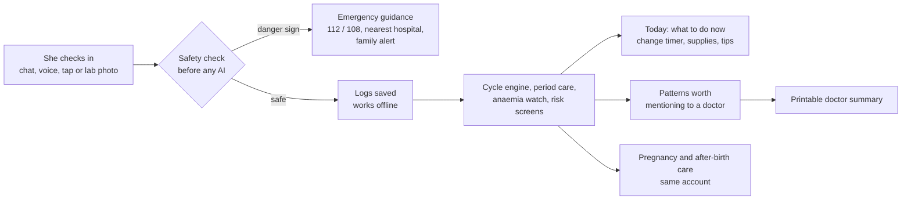
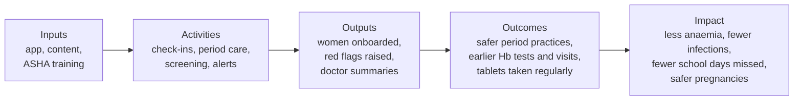

# SAKHI: Submission Draft

**SAKHI turns a woman's everyday period check-ins into practical period care, early warnings and a doctor-ready history, in her own language, even offline.**

How to use this draft:
- **[VERIFY]** marks a figure that must be checked against the original source before submitting.
- **[TEAM TO FILL]** marks something only the team can provide, such as pilot results or a funding amount.
- Content here describes what the app does today. See [SAKHI_NOVELTY_AND_RESEARCH_COMPARISON.txt](SAKHI_NOVELTY_AND_RESEARCH_COMPARISON.txt) for the detailed comparison.

---

## 1. Problem & Target Beneficiaries

### The problem

Menstrual health in India is not only about getting pads. Girls and women face four linked problems:

1. **Hygiene and access.** Many still use cloth or other materials without knowing how to clean and dry them safely, and some cannot afford pads every month.
2. **Silence and myths.** Periods are treated as impure: no bathing, no kitchen, no talking about it. Girls learn little, and warning signs get ignored.
3. **Hidden illness.** Heavy or irregular periods are often a sign of anaemia, PCOS or thyroid problems. Without a record of her cycles, these are found late.
4. **No continuity.** When she becomes pregnant, her history is lost. Paper records, separate apps and short clinic visits mean doctors see little of her history.

### Key figures (all [VERIFY] against the original reports)

| Figure | Source |
|---|---|
| About 57% of women aged 15–49 are anaemic | NFHS-5 (2019–21), India Fact Sheet |
| About 77% of women aged 15–24 use a hygienic method of period protection. It is lower in rural areas (about 73%) than in cities (about 89%), so around 1 in 4 still don't | NFHS-5 (2019–21) |
| About half of women aged 15–24 use cloth, often alongside other methods | NFHS-5 (2019–21) |
| PCOS prevalence in India is estimated at about 4% to 22%, depending on the criteria used | Ganie et al., *Indian J Med Res*, 2019 |
| About 10 lakh ASHA workers are the first point of contact for women's health in villages | MoHFW / NHM |
| Jan Aushadhi Suvidha pads are sold at about ₹1 a pad through more than 10,000 Janaushadhi Kendras | PMBI (Pradhan Mantri Bhartiya Janaushadhi Pariyojana) |

### Who we serve

| Profile | Her situation today | What SAKHI changes |
|---|---|---|
| **Kavya, 17, school student in a small town** | Uses cloth and dries it indoors because she is embarrassed. Misses school on heavy days. Believes she shouldn't bathe on her period. | Cloth-care guidance (wash, sun-dry, replace), a daily myth-busting card, a change timer, and where to get ₹1 Suvidha pads. Heavy-flow days feed the iron check. |
| **Lakshmi, 26, homemaker in a village, shares her husband's phone** | Irregular periods for two years and always tired. Has never had a blood test. Can't keep health information private. | Discreet mode with PIN and a neutral title. Voice chat in Tamil. Cycle patterns and the anaemia watch suggest an Hb test and a PHC visit. A printable doctor summary. |
| **Meera, 24, first pregnancy, supported by an ASHA worker** | Her readings are on paper. Doesn't know which government schemes she qualifies for. Unsure which symptoms are dangerous. | Same account as before pregnancy. Logs BP and sugar in chat, with red-flag escalation, scheme eligibility, and a tablet ledger for IFA and calcium. Switches to after-birth care when the baby comes. |

### Geography

Phase 1 focuses on one district in a Tamil- or Telugu-speaking state, so the languages Sakhi already supports match the local ASHA network. **[TEAM TO FILL: chosen district]**

### Unmet needs

- Period care advice that fits the product she actually uses, including cloth.
- A private place to track her cycle on a shared phone.
- A simple signal for when heavy periods or tiredness need a blood test.
- One record from her first period through pregnancy, in her language, that works with weak signal.

### Field evidence

**[TEAM TO FILL]** Interview 10–20 women and 3–5 ASHA workers or ANMs. Add quotes, the 5 most common problems they raise, and photos (with consent).

---

## 2. Solution & Value Proposition

### How it works

### Key features

**Period care (menstrual hygiene)**
- Guidance for each product: pad, cloth, cup, tampon or period underwear.
- A change timer.
- A supply check that warns before she runs out.
- Safe disposal advice.
- Low-cost access: Jan Aushadhi, ASHA workers, and map search for the nearest place.
- Warning signs of infection and toxic shock.
- A daily myth-busting card.

**Cycle and health**
- A cycle engine that learns her own cycle.
- A pain relief toolkit.
- An anaemia watch.
- PCOS-style pattern checks.
- Lab report reading.
- A tablet ledger.
- A mood check with Tele-MANAS (14416).

**Pregnancy and after birth**
- Week-by-week guidance.
- BP and sugar screening.
- Scheme eligibility.
- A contraction timer.
- Postnatal recovery checks.
- A vaccine schedule.

**Built for India**
- English, Hindi, Tamil and Telugu.
- Voice.
- Discreet mode.
- Offline logging.
- Keeps working without AI.

### Value for each stakeholder

| Stakeholder | Value |
|---|---|
| The woman | Knows what is normal, what to do today and when to see a doctor. Advice is private and in her language. |
| ASHA worker / ANM | Women arrive better informed. Red flags are surfaced early. Scheme eligibility is worked out for them. |
| Doctor | A one-page summary of her cycles, vitals, labs, tablets and mood instead of memory. |
| Health department | Supports the menstrual hygiene, anaemia, antenatal care and immunisation goals it already has. |

### Demo

Follow the steps in [DEMO.md](DEMO.md). **[TEAM TO FILL: link to a 2-minute screen-recorded video]**

---

## 3. Innovation & Differentiation

| Type | Innovation |
|---|---|
| Technical | Safety check before any AI. Keeps working without AI, the ML service or a connection. Scores only from readings she entered. Lab photo reading with a review step. |
| Menstrual hygiene | Period care tailored to her product, including cloth. A change timer. A supply estimate from her own period length and flow. Hygiene answers in the offline chat. |
| Social | Discreet mode for shared phones. Built to work through ASHA workers. Government scheme matching. Family alert. |
| India-specific | 1-0-1 tablet patterns tied to her meal times. UIP vaccine schedule. DIPSI and WHO reference ranges. Jan Aushadhi links. |

The full comparison table against paper records, global period apps and government programmes is in [SAKHI_NOVELTY_AND_RESEARCH_COMPARISON.txt](SAKHI_NOVELTY_AND_RESEARCH_COMPARISON.txt).

**IP status:** none filed yet. Next steps:
- Register the SAKHI name and logo as a trademark.
- Check whether the safety-first chat design can be protected.

---

## 4. Prototype, Validation & Evidence

### Development stage

A working prototype at roughly technology readiness level 5–6: complete and running end to end, deployable on Vercel, not yet tested with real users.

### What is tested today

| Evidence | Result |
|---|---|
| Automated tests (`cd frontend && npm test`) | 36 tests passing. They cover period care (change timer, supplies, content), the safety check, the cycle engine, the tablet schedule, the anaemia watch and the hygiene chat answers. |
| Type check (`npx tsc --noEmit`) | Clean |
| Preeclampsia model, 5-fold cross-validation | ROC-AUC 0.84, sensitivity 0.87 at the screening cut-off |
| Gestational diabetes model, 5-fold cross-validation | ROC-AUC 0.83, sensitivity 0.85 at the screening cut-off |
| Python vs TypeScript model check | `python scripts/check_parity.py` confirms both copies give the same results |

### Not yet done

These are planned, not finished:

- **Usability pilot:** 20–50 women for 2–4 weeks, measuring how many keep using it, task completion, a usability score (SUS) and satisfaction. **[TEAM TO FILL]**
- **Clinician review:** a gynaecologist checks the red-flag rules and the hygiene and health advice. **[TEAM TO FILL]**
- **Safety-check accuracy:** test 100+ written messages in 4 languages for missed emergencies and false alarms.
- **Lab-reading accuracy:** test 30+ real lab reports.
- **Indian data:** retrain and validate the risk models on Indian data with a hospital partner.

### Changes made from testing

**[TEAM TO FILL after the pilot]**

---

## 5. Market, Adoption & Scalability

### Market size (estimates, [VERIFY])

| Level | Estimate | Basis |
|---|---|---|
| Women aged 15–49 in India | about 35–37 crore | Census population projections |
| …who own or share a smartphone | [VERIFY] | GSMA Mobile Gender Gap Report; NFHS-5 mobile phone use |
| First district (Phase 1) | [TEAM TO FILL] | District census figures |

### Stakeholders

- **Users:** girls and women aged 13–49.
- **Ways to reach them:** ASHA workers, ANMs, schools and colleges, women's self-help groups, NGOs.
- **Clinical partners:** PHCs, district hospitals, medical colleges.
- **Funders and adopters:** state NHM, CSR teams.
- **Programmes it fits with:** Jan Aushadhi, menstrual hygiene schemes, Tele-MANAS, PMSMA.

### How women will hear about it

1. **ASHA workers:** introduce it during home visits and village health and nutrition days.
2. **Schools and colleges:** as part of period-health sessions.
3. **Self-help groups and NGOs:** through community meetings.
4. **Hospitals:** QR codes on antenatal care cards and in OPD waiting areas.

### Scale-up plan

| Phase | Scope |
|---|---|
| 1 | One district, 1–2 languages, pilot with ASHA workers |
| 2 | One state, 2–3 languages, an NGO or NHM partner |
| 3 | Several states, more languages (Kannada, Marathi, Bengali) |
| 4 | National, linked with ABHA (Ayushman Bharat Health Account) and NHM programmes |

**Why the technology scales:**
- It is a web app that works on low-cost Android phones and uses little data.
- It keeps working without AI or a connection.
- AI replies are capped per user per day.

---

## 6. Business Model & Sustainability

### Model

Free for women, paid for by institutions:

| Who pays | What they get |
|---|---|
| State NHM / district health office | A licence or annual maintenance contract for district roll-out, an ASHA-worker view and reports with no personal details |
| CSR funders | Funding for deployment in a district, with impact reports |
| NGOs and hospitals | A white-label version for their programmes |

No ads. No selling of data.

### Cost per user per month (estimates, [VERIFY current prices])

**Assumptions:**
- About 30 AI chat replies per user per month.
- About 3,000 input and 300 output tokens per reply.
- Gemini 2.5 Flash-Lite at about $0.10 per million input tokens and $0.40 per million output tokens.
- Hosting on Vercel plus a managed PostgreSQL database.
- ₹85 to the dollar.

| Users | AI | Hosting + database | Total per user per month |
|---|---|---|---|
| 1,000 | about ₹1.1 | about ₹4 | **about ₹5** |
| 10,000 | about ₹1.1 | about ₹0.4 | **about ₹1.5** |
| 1,00,000 | about ₹1.1 | about ₹0.25 | **about ₹1.4** |

Training ASHA workers and support staff are extra. **[TEAM TO FILL]**

**How costs are kept low:**
- The offline engine answers many questions with no AI cost.
- A per-user daily limit caps AI spending.
- An optional local model removes AI costs entirely.

### Who does what

| Role | Responsibility |
|---|---|
| Woman | Signs up herself, or with help from her ASHA worker |
| Content team and clinical advisory board | Review guidance every quarter |
| Tech team | Maintains the app and responds to incidents |
| Partner NGO / NHM | Trains ASHA workers and supports users locally |

### Long-term sustainability

- Clinical content is kept up to date by an advisory board.
- The code is open to government reuse.
- It is not locked to one AI vendor: it can switch to Gemini, a local model or no AI at all.

---

## 7. Impact, Roadmap & Support Required

### Theory of change

### KPIs (targets for the first 12 months, [TEAM TO FILL] exact numbers)

| Area | KPI |
|---|---|
| Reach | Women onboarded; monthly active users; ASHA workers trained |
| Period care | Share using a hygienic method; share with enough supplies before their period; myth cards read |
| Health | Red flags raised and acted on; anaemia flags followed by an Hb test; PCOS-pattern users who saw a doctor |
| Behaviour | Tablets taken on time; antenatal visits attended; mood checks completed |
| Education | Self-reported school or college days missed because of periods (before vs after) |
| Experience | Satisfaction score; trust in the advice |

### Environmental impact

Clear guidance on cloth and menstrual cups makes reusable products a safe choice. The disposal advice for each product reduces flushing and dumping in open drains.

### Roadmap

| When | Milestone |
|---|---|
| Next 3 months | Clinician review; pilot with 50 users; demo video; trademark filed |
| 6 months | 1,000 users in one district; ASHA-worker view; hygiene content in Hindi, Tamil and Telugu |
| 12 months | State partnership; 10,000+ users; Indian-data validation of the risk models begins |
| 18–24 months | Integration with ABHA and NHM; more languages |

### Risks and mitigation

| Risk | Mitigation |
|---|---|
| Wrong or unsafe advice | Safety check before AI; clinician review; every warning points to a doctor or 112/108 |
| Privacy breach / shared phone | Consent first; discreet mode; export and delete her data; DPDP Act 2023 compliance review |
| Low digital literacy | Voice; Indian languages; ASHA-assisted onboarding |
| AI outage or cost spike | Offline engine; daily limit; local model option |
| Low uptake | Community champions; school sessions; ASHA incentives through partners |
| Regulation (medical device rules) | Positioned as wellness and screening support, not diagnosis; get CDSCO guidance early |

### Support required

| Ask | Details |
|---|---|
| Funding | [TEAM TO FILL: amount] for the pilot and first year (development, content translation, ASHA training, hosting) |
| Clinical partner | A gynaecology department to review content and co-run validation |
| Pilot access | One district, with NHM or NGO support and ASHA workers |
| Mentoring | Regulation (CDSCO, DPDP), public health partnerships, impact measurement |
| Credits | Cloud and AI credits for the first year |
